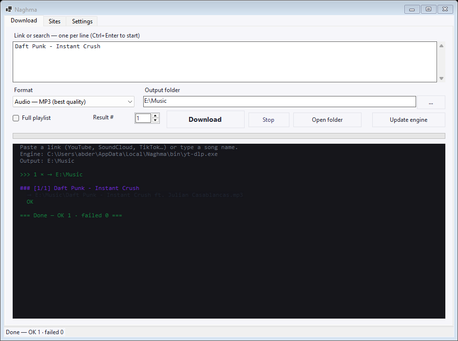
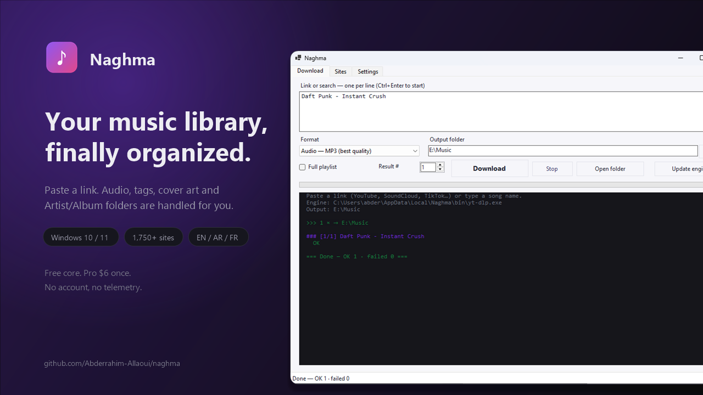
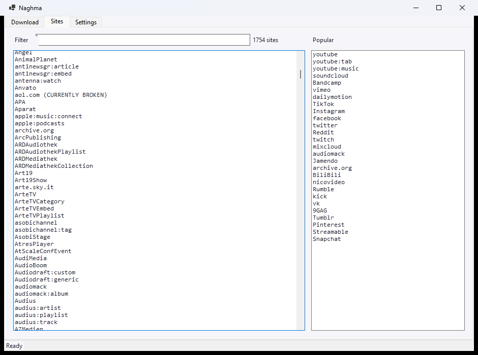

# Naghma · نغمة

**Download, tag and organize your music library — from 1,750+ sites.**

Naghma is a Windows desktop app for people who actually keep a music library: it pulls audio
(and video) from the sites you already use, cleans the metadata, embeds cover art, and files
everything under `Artist / Album / 01 - Title`. No browser, no ads, no command line.

<p align="center">
  
</p>

<p align="center">
  <a href="assets/demo.mp4"></a>
  <br><sub><b>▶ 19-second demo</b> — paste a name, press Download, the file lands tagged</sub>
</p>

---

## Why another downloader?

Because most of them stop at "download". Naghma is a **library tool**:

| | |
|---|---|
| **Engine** | [yt-dlp](https://github.com/yt-dlp/yt-dlp) — 1,750+ extractors, updated automatically |
| **Formats** | MP3 · M4A · OPUS · FLAC · MP4 |
| **Tags** | artist, title, album, year, track number — written to the file |
| **Cover art** | embedded automatically (mp3/m4a/flac) |
| **Naming** | `Artist - Title.mp3` by default, `Artist/Album/01 - Title.mp3` in Pro |
| **Languages** | English · العربية · Français (auto-detected, RTL for Arabic) |
| **Portable** | single `.exe`, no installer, no admin rights |

---

## Free vs Pro

| Feature | Free | Pro ($6, one-time) |
|---|:--:|:--:|
| Download from 1,750+ sites | ✅ | ✅ |
| MP3 / M4A / OPUS / FLAC | ✅ | ✅ |
| MP4 up to 720p | ✅ | ✅ |
| Tags + embedded cover | ✅ | ✅ |
| Single downloads | ✅ | ✅ |
| **Batch queue (unlimited)** | – | ✅ |
| **Playlist / album / channel** | – | ✅ |
| **MP4 1080p / 4K / HDR** | – | ✅ |
| **Auto-organize `Artist/Album/01 - Title`** | – | ✅ |
| **Duplicate detection** | – | ✅ |
| **Export library to phone (M3U)** | – | ✅ |
| Priority support | – | ✅ |

No subscription. One key, works offline, valid forever.

**[Get Pro — $6](https://abderrahim-allaoui.github.io/naghma/#pricing)** · [What Pro adds](https://abderrahim-allaoui.github.io/naghma/#pricing)

---

## Install

1. Download `Naghma-win-x64.zip` from [Releases](../../releases/latest).
2. Extract anywhere (Desktop, USB stick…).
3. Run `Naghma.exe`.

On first launch Naghma downloads its engine (`yt-dlp` + `ffmpeg` + `deno`, ~170 MB total) into
`%LOCALAPPDATA%\Naghma\bin`. Nothing else is installed, no registry keys. If you already have
`ffmpeg` on your `PATH`, Naghma reuses it and skips that download.

> **Requirements:** Windows 10 / 11 (x64). No Python, no PowerShell modules, no admin.

---

## Supported sites

1,750+ extractors, including:

- **Video:** YouTube, YouTube Music, Vimeo, Dailymotion, Twitch, Bilibili, Rumble, Kick, VK
- **Audio:** SoundCloud, Bandcamp, Mixcloud, Audiomack, Jamendo, Archive.org
- **Social:** TikTok, Instagram, Facebook, X, Reddit, 9GAG, Tumblr, Pinterest, LinkedIn
- **Streaming:** Hotstar, Zee5, SonyLIV, Naver, Odnoklassniki

Full list: open the **Sites** tab in the app, or run `yt-dlp --list-extractors`.
See [yt-dlp's supported sites](https://github.com/yt-dlp/yt-dlp/blob/master/supportedsites.md).

<p align="center">
  
</p>

**Not supported:** Spotify, Apple Music, Deezer, Anghami — these are DRM-protected and expose
no media URL. Paste the **song name** instead: Naghma searches YouTube Music and downloads the
matching audio, tags included.

---

## Build from source

```powershell
git clone https://github.com/Abderrahim-Allaoui/naghma.git
cd naghma
dotnet build src/Naghma/Naghma.csproj -c Release
```

Portable single-file build:

```powershell
dotnet publish src/Naghma/Naghma.csproj -c Release -r win-x64 `
  --self-contained true -p:PublishSingleFile=true -p:IncludeNativeLibrariesForSelfExtract=true `
  -o publish
```

See [docs/BUILD.md](docs/BUILD.md) for the release pipeline.

---

## How it works

Naghma is a front-end: it builds the right `yt-dlp` arguments, streams the output, parses
progress, and moves finished files into place. It never contacts a third-party API of its own —
everything happens on your machine.

```
Naghma.exe
 ├─ ui/          WinForms, dark/light, i18n (en / ar / fr)
 ├─ engine/      yt-dlp process orchestration, progress, queue
 ├─ library/     tagging, naming, duplicate detection, M3U export
 └─ tools/       yt-dlp.exe + ffmpeg.exe (auto-downloaded)
```

Naghma does not host, index or distribute any media. It runs a download engine on your computer,
for content you are allowed to access. Respect the terms of the services you use.

---

## Contributing

Bug reports and PRs are welcome. Read [CONTRIBUTING.md](CONTRIBUTING.md) first.

- 🐛 [Report a bug](../../issues/new?template=bug_report.yml)
- 💡 [Request a feature](../../issues/new?template=feature_request.yml)
- 🌍 Add a translation: drop a `locales/xx.json` file and open a PR.

## License

The free core is **MIT** — see [LICENSE](LICENSE).
Pro modules are closed source and shipped as signed releases.
